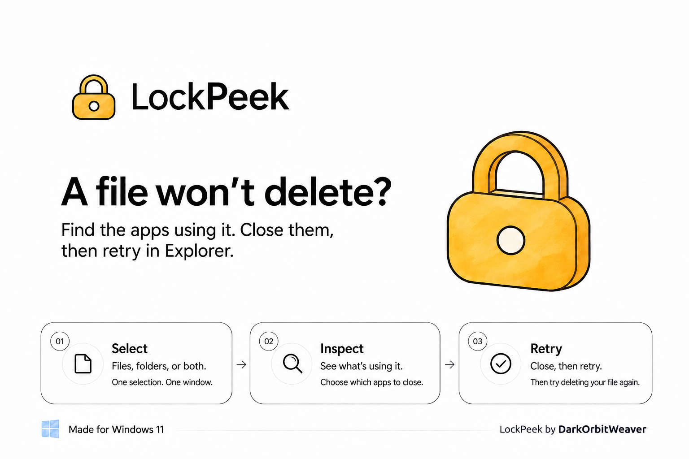

<p align="center">
  
</p>

<p align="center">
  <a href="https://apps.microsoft.com/detail/9NN3B2GFR71R">
    
  </a>
</p>

<p align="center">
  
  
  
  
</p>

**That file won't delete because it's in use? Find out what's holding it.**

LockPeek is a native Windows 11 utility for discovering which applications and background processes are holding open handles to your files or folders. Right-click any file or folder in Explorer, see what's using it in real-time, close eligible apps gracefully, or force end stubborn processes when necessary.

## Installation

### Option 1: Microsoft Store (Recommended)
One-click install directly from the Microsoft Store (no Microsoft account required):

<p align="left">
  <a href="https://apps.microsoft.com/detail/9NN3B2GFR71R">
    
  </a>
</p>

### Option 2: Windows Package Manager (`winget`)
Run from PowerShell or Command Prompt:

```powershell
winget install DarkOrbitWeaver.LockPeek
```

### Option 3: Direct Downloads (GitHub Releases)
Grab the files directly from [GitHub Releases](https://github.com/DarkOrbitWeaver/LockPeek/releases):
* **`LockPeek-x64.msix`:** 1-click installer with full Windows 11 Explorer right-click integration.
* **`LockPeek.exe`:** Single-file standalone executable (no installation required; drag & drop files directly into the window).

## How to Use

1. Right-click any file, folder, or multi-selection in File Explorer.
2. Select **Find apps using this file** (or **this folder** / **these items**).
3. Review the detected applications with real-time scan progress.
4. Choose **Close normally** to request a graceful shutdown, or **Force end** for background daemons or frozen apps.
5. You can also drag and drop files directly into the LockPeek window.

## Key Features

- **Explorer Integration:** Native Windows 11 modern context menu integration via lightweight C++ Shell extension (`IExplorerCommand`).
- **High-Performance Handle Scanner:** Custom parallel NT system handle scanner queries open handles across all CPU cores in milliseconds.
- **Multi-File & Folder Aggregation:** Scan thousands of files and nested directories in a single unified view.
- **Safe by Design:** Never silently escalates a graceful close into a force-kill. Windows system components, Explorer shell, and critical background services are protected against accidental termination.
- **Recycle Bin Integration:** Safely delete unlocked items straight to the Windows Recycle Bin with standard Windows safeguards.
- **Modern Fluent Design:** Native WinUI 3 interface with Mica styling, dark and light theme support, and fluid layout.
- **Zero Bloat:** No resident background daemons, telemetry, or account requirements. Fully exits on close.

## Building from Source

### Prerequisites

- Windows 11 (x64)
- [.NET 10 SDK](https://dotnet.microsoft.com/)
- [LLVM-MinGW](https://github.com/mstorsjo/llvm-mingw) (for compiling the native Shell extension DLL)

### Build Commands

```powershell
# Build solution
dotnet build LockPeek.sln -c Release

# Run integration tests
dotnet run --project tests/LockPeek.Tests -c Release
```

## Privacy

LockPeek processes all file handles and process metadata entirely on your local PC. It does not collect telemetry or transmit any data over the network. See [PRIVACY.md](docs/PRIVACY.md).

## License

See [LICENSE](LICENSE) for terms.
